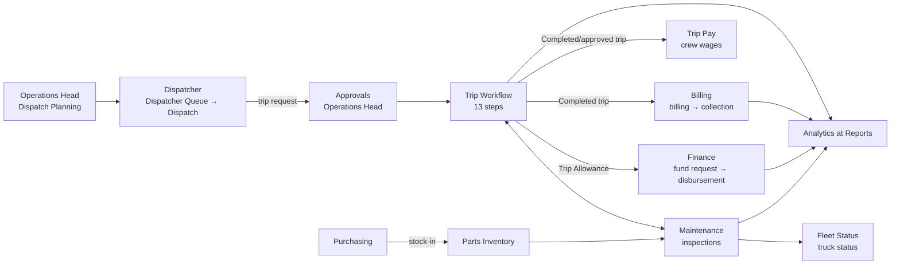
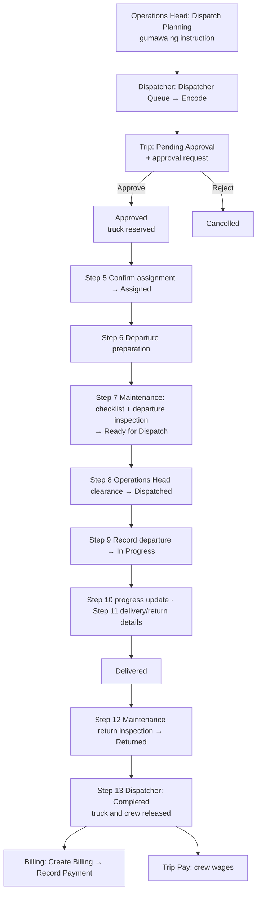
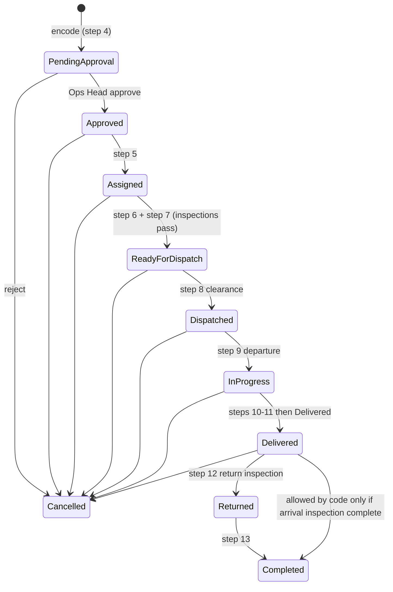
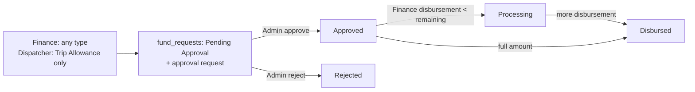

# Gabay sa Sistema ng Mulawin FleetOps

**Kumpletong gabay para sa mga nagsisimula: paano gumagana ang system, paano ito gamitin, saan nanggagaling ang data, at paano kinakalkula ang analytics.**

Ginawa: 2026-10-27 · Branch `system-hardening` · HEAD `f13b060` (may mga hindi pa naka-commit na pagbabago sa working tree)

---

## Paano basahin ang gabay na ito (antas ng ebidensya)

Lahat ng nakasulat dito ay galing sa **pagbasa ng aktuwal na code** sa repository. Hindi ito galing sa hula mula sa pangalan ng file o menu.

| Tatak | Ibig sabihin |
|---|---|
| **[CODE]** | Nakita at sinundan sa source code (PHP, JS, SQL). |
| **[TEST]** | May automated test na sumusuporta (`tests/unit/run.php`, `tests/static/run.php`). Ang mga test na ito ay gumagamit ng *stub* (pekeng database), hindi totoong MariaDB. |
| **[DB]** | Nakita sa read-only na pagsilip sa schema at mga setting ng `mulawin_fleetops_test` database (mga table, column, ENUM, role grants). Walang binago. |
| **[HINDI PA NA-VERIFY]** | Hindi pa nasubukan sa browser o gamit ang totoong data. |

> **Mahalaga:** Walang browser testing na ginawa para sa gabay na ito. Ang mga `docs/testing/*_checklist.md` ng proyekto ay nagsasabi pa ring **NOT TESTED**. Kaya ang "gumagana" dito ay nangangahulugang "ganito ang sinasabi ng code", hindi "nakita kong gumana sa screen".

Ang mga numero ng linya (hal. `ajax/billing_handler.php:166`) ay tumutukoy sa kasalukuyang bersyon ng file noong isinulat ito.

---

## Talaan ng Nilalaman

1. [Ano ang Mulawin FleetOps?](#kabanata-1--ano-ang-mulawin-fleetops)
2. [Paano ginagamit ang system mula simula hanggang matapos?](#kabanata-2--paano-ginagamit-ang-system-mula-simula-hanggang-matapos)
3. [Lahat ng aktuwal na user roles](#kabanata-3--lahat-ng-aktuwal-na-user-roles)
4. [Kumpletong page-by-page guide](#kabanata-4--kumpletong-page-by-page-guide)
5. [Complete workflow guide](#kabanata-5--complete-workflow-guide)
6. [Database at pinanggagalingan ng data](#kabanata-6--database-at-pinanggagalingan-ng-data)
7. [Complete analytics guide](#kabanata-7--complete-analytics-guide)
8. [Permissions, validation, at safeguards](#kabanata-8--permissions-validation-at-safeguards)
9. [Practical task recipes](#kabanata-9--practical-task-recipes)
10. [Troubleshooting at FAQ](#kabanata-10--troubleshooting-at-faq)
11. [Kakayahan, limitasyon, at hindi pa tapos](#kabanata-11--kakayahan-limitasyon-at-hindi-pa-tapos)
12. [Technical reference at evidence index](#kabanata-12--technical-reference-at-evidence-index)

---

## Kabanata 1 — Ano ang Mulawin FleetOps?

### 1.1 Layunin

Ang **Mulawin FleetOps** ay isang web application (PHP + MariaDB, tumatakbo sa XAMPP) para sa isang trucking/logistics na kumpanya na may tatlong uri ng truck: **Car Carrier**, **Container**, at **Wing Van** (`trips.trip_type`, `trucks.truck_type`, [DB]).

Pinag-iisa nito sa iisang system ang mga gawain na dati ay hiwa-hiwalay (halimbawa, sa spreadsheet):

| Lugar ng negosyo | Ano ang ginagawa ng system [CODE] |
|---|---|
| **Dispatch at Trips** | Gumagawa ng dispatch instruction ang Operations Head. Ine-encode ito ng dispatcher bilang trip request. Inaaprubahan ito, saka sinusundan ang trip sa 13 hakbang hanggang matapos. |
| **Fleet at Maintenance** | Listahan ng truck at status nito; pre-departure at return inspection; repair work order; preventive maintenance (PM) schedule. |
| **Parts at Purchasing** | Imbentaryo ng piyesa, galaw ng stock, supplier, purchase order na may approval, at pagtanggap ng delivery. |
| **Billing at Collections** | Paggawa ng billing para sa natapos na trip at pagtala ng bayad ng kliyente. |
| **Finance** | Fund request (kasama ang Trip Allowance at Cash Advance), approval, disbursement, accounts payable, at payment voucher. |
| **Payroll** | Pagtala ng periodic salary payment at hiwalay na per-trip na sahod ng driver/helper (Trip Pay). |
| **Tao at Records** | Attendance, user at employee records, mga dokumento, kliyente, office supplies, recruitment (Admin lang). |
| **Reports at Analytics** | Fleet Overview, Billing & Collections Analytics, Maintenance Analytics, Dispatcher Reports, Operations Maintenance Report, at Audit History. |
| **Suporta** | Notification bell, announcements, approvals, audit log, recycle bin, at backup. |

### 1.2 Paano magkakaugnay ang mga lugar



### 1.3 Ano ang KAYA ng system ngayon, at ano ang HINDI

| Kaya [CODE] | Hindi pa kaya / labas sa saklaw [CODE] |
|---|---|
| Buong trip lifecycle mula instruction hanggang Completed, may approval at inspection gates | Walang GPS o real-time tracking. Ang "Trip Monitoring" ay batay sa mga status at update na manual na inilalagay. |
| Billing na naka-link sa natapos na trip; hiwalay na pagtala ng mga bayad | Walang automatic na pagbuo ng invoice PDF; walang aging report ng receivables sa analytics. |
| Fund request → Admin approval → Finance disbursement (puwedeng partial) | Hindi pa naipapatupad ang **liquidation** ng cash advance (may table `cash_advance_liquidations` pero walang code na gumagamit nito). |
| Pagtala ng payroll payment at Trip Pay | Walang automatic na kalkulasyon ng SSS/PhilHealth/Pag-IBIG o buwis. Manual ang mga deduction. Hindi dumadaan sa approval ang payroll (tingnan ang Kabanata 5.7). |
| Descriptive analytics (bilang, kabuuan, trend) | Walang predictive analytics (forecast). May diagnostic/prescriptive code na **hindi ginagamit** ng anumang page. |
| CSV export ng trips, billing at attendance | Walang PDF o Excel export. |

### 1.4 Mahahalagang limitasyon na dapat alam ng user

1. **Hindi pa na-browser-test** ang mga workflow (tingnan ang simula ng gabay).
2. **May mga minimum na oras ang inspections**: 5 minuto ang pre-trip checklist, 5 minuto ang departure inspection, at **15 minuto** ang return at iba pang inspection (`config/app.php:25,30,31`, [CODE][TEST]).
3. **Hindi lahat ng "status" ay snapshot ng ngayon.** May mga analytics card na nakatali sa napiling period. Tingnan ang Kabanata 7.
4. **Hindi magkapareho ang depinisyon ng "overdue" at "maintenance cost"** sa lahat ng pahina (Kabanata 7.8).

---

## Kabanata 2 — Paano ginagamit ang system mula simula hanggang matapos?

### 2.1 Pagpasok sa system

1. Buksan ang `http://localhost/mulawin_fleetops/` (`.htaccess` → `DirectoryIndex login.php`).
2. Ilagay ang **username** at **password**, saka pindutin ang **Sign In**.
3. Ipinapadala ang form (POST) sa `auth/login_handler.php`, na:
   - sumusuri ng **CSRF token** (proteksyon laban sa pekeng form galing sa ibang site);
   - may **login throttle**: pagkatapos ng 10 maling subok para sa isang account, o 50 mula sa isang IP, sa loob ng 15 minuto, pansamantalang tinatanggihan ang login (`auth/login_handler.php:16-18`);
   - kapag tama: gumagawa ng bagong session ID, nagtatala ng `LOGIN` sa `audit_logs`, at dinadala ka sa **Home** (`pages/dashboard.php`). Lahat ng role ay napupunta sa iisang Home, dahil walang laman ang `ROLE_KEY_DASHBOARDS` (`includes/session.php:307`).
4. **Logout**: menu ng account (pangalan sa itaas-kanan) → **Log Out**. May confirm na "Log out of Mulawin FleetOps?". Nagtatala ito ng `LOGOUT` sa audit log (`auth/login_handler.php:158-177`).
5. **Auto-logout**: sa menu ng account ay may toggle na "Auto log out when inactive". **Kapag naka-on lang ito** saka ka nilalabas pagkalipas ng `SESSION_TIMEOUT` (default 1800 segundo = 30 minuto) na walang galaw (`includes/session.php:50-57`).

### 2.2 Paglipat-lipat ng pahina

- **Sidebar** (kaliwa): ang mga link ay naka-grupo sa *Approvals* (sa itaas), *Fleet Management*, *Trip & Dispatch*, *Maintenance & Inspection*, *Financial & Billing*, *Employee & Records*, at *Reports & Administration* (`includes/layout.php`, function `getNavItems()`).
- Ipinapakita lang ang isang link kung pasado ka sa permission check nito (`navItemVisible()`, `includes/layout.php:92-109`).
- **Notification bell**: mga abiso para sa iyo (Kabanata 5.11).
- **Home**: mga summary card at "Work to Address" (mga gawaing naghihintay sa iyo).

### 2.3 Ang karaniwang daloy ng isang trip (buod)



Ang bawat hakbang ay nakatala sa `workflow_events` (Kabanata 5.2) [CODE].

### 2.4 Paano lumilipat ang impormasyon mula sa isang proseso papunta sa iba

| Galing | Papunta | Ano ang dumadaloy [CODE] |
|---|---|---|
| Dispatch Planning (`client_bookings`) | Dispatcher Queue / Dispatch | Mga instruction na `Pending` na kailangang i-encode |
| Dispatch (`trips` + `dispatch_requests`) | Approvals | `approval_requests` para sa Operations Head |
| Trip Workflow | Maintenance | Mga trip na kailangan ng pre-departure at return inspection |
| Trip (Trip Allowance) | Finance | `fund_requests` na `request_type = 'Trip Allowance'`. Hindi makakaalis ang truck hangga't hindi ito fully disbursed. |
| Completed trip | Billing | Ang "unbilled" tab ay naglilista ng `trips.status = 'Completed'` na wala pang `billings` |
| Purchasing (receive) | Parts Inventory | `inventory_transactions` (Stock In) at `inventory.quantity_on_hand` |
| Lahat ng nasa itaas | Analytics / Reports | Binabasa ang parehong mga table (Kabanata 7) |

### 2.5 Kapag may kulang, tinanggihan, o nagbago ang status

- **Kulang na impormasyon**: tumatanggi ang handler gamit ang `jsonFail('...')`, na may mensaheng gaya ng "Enter a cancellation reason before cancelling this trip." Walang nasi-save.
- **Tinanggihan ang approval**: nagiging `Rejected` ang request. Kung dispatch request ito, ang trip ay nagiging `Cancelled` (`ajax/review_dispatch.php:232`).
- **Maling pagkakasunod-sunod**: halimbawa, gusto mong gawing `Delivered` ang trip na hindi pa `In Progress`. Ang mensahe ay "Trip status must follow the operational sequence…" (`ajax/update_trip_status.php`).
- **Walang permission**: HTTP 403 at ang pahinang `pages/403.php`. Para sa AJAX, JSON na "You do not have permission to perform this action."

---

## Kabanata 3 — Lahat ng aktuwal na user roles

### 3.1 Role kumpara sa permission (simpleng paliwanag)

- **Role**: ang "posisyon" ng user (hal. Finance). Isang role lang ang bawat user account (`users.role_id`).
- **Permission**: isang tiyak na karapatan, gaya ng `billing.manage` ("puwedeng gumawa ng billing at magtala ng bayad").
- Ang role ay may listahan ng permissions (`role_permissions`). Ang code ay laging tumitingin sa **permission**, hindi sa pangalan ng role. Halimbawa: `requirePermission('billing.manage')` sa `ajax/billing_handler.php:26`.
- **Admin**: laging pasado sa *anumang* permission check (`currentUserHasAnyPermission()` → `if (isAdmin()) return true;`, `includes/session.php:231-236`).

### 3.2 Ang 12 aktuwal na role at kanilang permissions [DB]

| Role (`system_key`) | Permissions (mula sa `role_permissions`) |
|---|---|
| **Admin** (`admin`) | Lahat (71/71) |
| **Operations Head** (`operations_head`) | approvals.review, clients.view, dispatch.clear, dispatch.instructions.manage, documents.download, documents.view, fleet.manage, fleet.view, incidents.manage, maintenance.reports.operations.view, maintenance.view, operations.dashboard.view, operations.reports.view, reports.view, routes.approve, routes.manage, trips.assign, trips.export, trips.view |
| **Car Carrier Dispatcher** (`car_carrier_dispatcher`) | clients.view, dispatch.instructions.encode, dispatch.reports.view, documents.download, documents.upload, documents.view, finance.trip_allowance.request, fleet.view, incidents.manage, routes.request, trips.assign, trips.create, trips.update, trips.view |
| **Container & Wing Van Dispatcher** (`container_wing_van_dispatcher`) | (kapareho ng Car Carrier Dispatcher; magkaiba lang ang saklaw na truck type, tingnan ang 8.4) |
| **Maintenance** (`maintenance`) | documents.download, documents.upload, documents.view, fleet.status.update, fleet.view, incidents.manage, legacy.role.3, maintenance.manage, maintenance.reports.view, maintenance.view, parts.view |
| **Purchasing Officer** (`purchasing_officer`) | admin.supplies.manage, admin.supplies.view, documents.download, documents.upload, documents.view, parts.catalog.manage, parts.manage, parts.view, purchasing.manage, purchasing.view |
| **Finance** (`finance`) | billing.view, budgets.manage, documents.download, documents.upload, documents.view, finance.ap.manage, finance.ap.view, finance.disbursements.manage, finance.disbursements.view, finance.expenses.edit, finance.funds.manage, finance.funds.view, finance.manage, finance.view, legacy.role.4 |
| **Billing and Collection** (`billing_collection`) | billing.export, billing.manage, billing.view, clients.manage, clients.view, documents.download, documents.upload, documents.view |
| **Payroll** (`payroll`) | documents.download, documents.view, hr.attendance.manage, hr.attendance.report, hr.attendance.view, payroll.manage, payroll.view |
| **Audit** (`audit`) | audit.view, billing.view, finance.ap.view, finance.disbursements.view, finance.funds.view, finance.view, payroll.view |
| **Driver** (`driver`) | trips.complete *(naka-grant pa, pero wala na itong naibibigay na kakayahan; tingnan ang 5.3)* |
| **Helper** (`helper`) | *(wala)* |

> Ang mga grant na ito ay galing sa test database. Puwedeng baguhin ng Admin ang role permissions sa `pages/permissions.php` (Admin lang, wala sa sidebar), kaya **suriin muli ang aktuwal na database** bago umasa sa talahanayang ito.

### 3.3 Ano ang ginagawa ng bawat role sa workflow

| Role | Mga gawain [CODE] | Hindi puwede [CODE] | Umaasa sa |
|---|---|---|---|
| **Admin** | Lahat; aprobador ng purchase, fund, voucher at payroll requests (`approval_workflow_steps`, [DB]); namamahala ng users, recycle bin, backup, permissions, announcements, at trucks | Walang hard block. Para sa mga hakbang ng ibang tao (hal. pag-update ng trip na isinumite ng ibang dispatcher, o pag-apruba ng sariling request), kailangan ng **override reason** na naitatala sa audit (8.3). | — |
| **Operations Head** | Gumagawa ng dispatch instruction; nag-aapruba o tumatanggi ng dispatch at route request; nagbibigay ng dispatch clearance (Step 8); trip export; Fleet Overview | Hindi nakakagawa ng billing, payroll, o fund disbursement | Dispatcher (encode), Maintenance (inspection) |
| **Dispatchers** | Nag-e-encode ng instruction bilang trip; Steps 5, 6, 9, 10, 11, 13 *ng sarili nilang trip*; humihiling ng Trip Allowance (para lang sa sariling `Assigned` na trip); route request; problem report | Hindi nakakapag-apruba; hindi nakakapag-update ng trip ng ibang dispatcher | Operations Head (approval, clearance), Maintenance, Finance (allowance) |
| **Maintenance** | Pre-trip checklist, departure at return inspection (Steps 7 at 12); work orders; PM schedules; maintenance records; truck status | Hindi nakakagawa ng trip o billing | Dispatcher (Step 6 bago ang inspection) |
| **Purchasing Officer** | Supplier; purchase order (gumagawa ng purchase request na kailangang aprubahan); pagtanggap ng delivery; parts; office supplies | Hindi nakakapag-apruba ng sariling PO (Admin ang aprobador) | Admin (approval) |
| **Finance** | Fund request (anumang uri); disbursement; accounts payable; payment voucher; trip costs at expense | Hindi nakakapag-apruba (Admin) | Admin (approval) |
| **Billing and Collection** | Gumagawa ng billing para sa Completed trip; nagtatala ng bayad; billing CSV export; namamahala ng client registry, locations at rates | — | Dispatcher (Completed trip) |
| **Payroll** | Nagtatala ng payroll payment; Trip Pay; Attendance | Hindi nakakapagtala ng periodic payroll para sa driver o helper (Trip Pay ang para sa kanila) | — |
| **Audit** | Nakakabasa ng Audit History, Billing, Finance, Payroll, at Billing & Collections Analytics | Read-only | — |
| **Driver** | Nakakakita ng sariling naka-assign na trip sa Home | Hindi nakakapag-ulat o nakakapag-complete ng trip: tinatanggihan ng `ajax/trip_completion_handler.php:15-16` ang Driver at Helper. Ang dispatcher ang nagko-complete ng trip (Step 13). | Dispatcher (pagkumpleto ng trip) |
| **Helper** | Nakakakita ng sariling naka-assign na trip (limitado) | Hindi nakakapag-ulat o nakakapag-complete ng trip (pareho sa Driver) | Dispatcher (pagkumpleto ng trip) |

### 3.4 Menu visibility ≠ authorization

Magkahiwalay ang dalawang ito:

1. **Sidebar (`navItemVisible`)**: itinatago lang ang link. Ilang item ay may `excluded_roles => ['admin']` (Dispatch Planning, Dispatcher Queue, Purchasing, Finance, Office Supplies), kaya **hindi nakikita ng Admin ang mga link na iyon**. Pero dahil pasado ang Admin sa lahat ng permission, **mabubuksan pa rin niya ang mga iyon kapag tinype ang URL**.
2. **Server-side check**: nasa itaas ng bawat page at handler (`requirePermission`, `requireAnyPermission`, `requireLogin`). Ito ang tunay na harang. Kapag bumagsak dito, makakatanggap ka ng 403 (`includes/session.php:207-229`).

---

## Kabanata 4 — Kumpletong page-by-page guide

> Format: bawat page ay may **Layunin · Sino · Makikita · Paano gamitin · Ano ang nangyayari · Saan napupunta / Saan galing ang data · Koneksyon · Status · Limitasyon · Paano malalaman na successful · Hindi nito ginagawa**. Kung walang sinabi, [CODE] ang ebidensya at **[HINDI PA NA-VERIFY]** sa browser.

### 4.1 Home (`pages/dashboard.php`)

- **Layunin:** panimulang pahina ng lahat ng role: buod at mga gawaing naghihintay.
- **Sino:** lahat ng naka-login (`requireLogin()`).
- **Makikita:**
  - Pagbati.
  - **Summary cards** na nakadepende sa permission:

| Card | Kailangan |
|---|---|
| Active trips | `trips.view` |
| Pending dispatch | dispatch queue access |
| Pending approvals | `approvals.review` |
| Available trucks | `fleet.view` |
| Open maintenance | `maintenance.view` |
| Low-stock parts | `parts.view` |
| Outstanding balances | `billing.view` |
| Payroll entries / paid this month | `payroll.view` |
| Purchase requests needing attention | `purchasing.view` |
| Audit counts (7 araw) | `audit.view` |

  - **Work to Address**: mga gawaing para sa iyo, binubuo mula sa *kasalukuyang* status ng mga record (`includes/home_tasks.php`).
  - Listahan ng active trips. Para sa driver o helper, ang mga trip na naka-assign sa kanila.
  - Quick actions.
- **Saan galing ang data:**
  - `dashboardActiveTripCount()`: mga trip na nasa `Assigned`, `Ready for Dispatch`, `Dispatched` o `In Progress` (`TRIP_ACTIVE_STATUSES`, `includes/metrics.php:23`).
  - `dashboardFleetCounts()`: bilang ng `trucks` ayon sa status.
  - `dashboardReceivables()`: billing na Issued, Partially Paid o Overdue, ang `total_amount` bawas ang nakolekta, kung higit sa 0 (`includes/dashboard_metrics.php:212`).
- **Paano malalaman na successful:** read-only ang pahinang ito. Kusang nawawala ang item sa "Work to Address" kapag tapos na ang gawain.
- **Hindi nito ginagawa:** hindi ito analytics. Ang mga numero ay "ngayon", hindi para sa isang period.

### 4.2 Approvals (`pages/requests.php`, sidebar: "Approvals")

- **Layunin:** isang lugar para mag-apruba o tumanggi.
- **Sino:** `approvals.review` (Operations Head at Admin).
- **Makikita:**
  - Dispatch Requests (kung ang role mo ay may step sa `dispatch` workflow, o Admin).
  - Route Requests.
  - "Purchasing, Fund, Voucher & Payroll Approvals".
  - "Recently Reviewed".
- **Paano gamitin:** piliin ang request, saka pindutin ang Approve o Reject. Kung tatanggi, maglagay ng remarks.
- **Ano ang nangyayari:**
  - Dispatch: `ajax/review_dispatch.php`.
  - Route: `ajax/route_request_handler.php` (`review`).
  - Iba pa: `ajax/approval_decision_handler.php`.
  - Lahat ay dumadaan sa `recordApprovalDecision()` (`includes/approval_workflow.php:335`), na nag-a-update ng `approval_steps`, `approval_requests` at `approval_history`.
  - Kapag huling step na, ipinapatupad ang desisyon sa mismong record (hal. `applyPurchaseRequestDecision()`).
- **Mga aprobador ayon sa workflow** [DB]:

| Workflow | Aprobador |
|---|---|
| `dispatch`, `route_request` | Operations Head |
| `purchase_request`, `fund_request`, `payment_voucher`, `payroll` | Admin |

  Kapag ang humihiling ay kabilang sa role ng aprobador, ang request ay nire-route sa Admin (`approvalStepsForRequester()`).
- **Status:** `approval_requests.status` ay `Pending`, `Approved`, `Rejected` o `Cancelled`.
- **Limitasyon:**
  - Hindi puwedeng aprubahan ang sariling request maliban kung Admin, at may override reason (`ajax/approval_decision_handler.php:83-94`).
  - Ang `payroll` workflow ay naka-configure pero **walang code na gumagawa ng payroll approval request** (Kabanata 5.7).
- **Paano malalaman na successful:** mawawala ito sa pending list, lalabas sa "Recently Reviewed", at makakatanggap ng notification ang humiling.

### 4.3 Fleet Status (`pages/fleet_status.php`)

- **Layunin:** listahan ng lahat ng truck, ang status nila, at ang kasalukuyang assignment.
- **Sino:** `fleet.view`. Ang pag-add o pag-edit ng truck ay Admin lang (`ajax/trucks_handler.php`). Ang pagpalit ng status ay `fleet.status.update` (Maintenance), via `ajax/update_truck_status.php`.
- **Makikita:** plate, unit, type, status, at mga truck document (OR, CR, Insurance) na may expiry (`truck_documents`).
- **Status ng truck** (`trucks.status`): `Available`, `Assigned`, `On Trip`, `Under Maintenance`, `Unavailable`.
- **Koneksyon:**
  - Ginagawang `Assigned` ng approval ng dispatch (`reserveTruckForTrip()`, `includes/dispatch_assignment.php:108`).
  - Ginagawang `On Trip` ng departure.
  - Ibinabalik sa `Available` ng completion o cancel (`releaseTruckForTrip()`).
  - Ginagawang `Under Maintenance` at pabalik ang work order.
- **Hindi nito ginagawa:** hindi nito kinakalkula ang utilization.

### 4.4 Dispatch Planning (`pages/dispatch_planning.php`)

- **Layunin:** dito naghahanda ang Operations Head ng **dispatch instructions** (Day/Night shift) para i-encode ng dispatcher.
- **Sino:** `dispatch.instructions.manage` (Operations Head). Nakatago ang link sa Admin.
- **Paano gamitin:**
  1. Pumili ng client, route, shift, truck type, dami (quantity) at scheduled departure.
  2. Isumite. Puwedeng isa-isa (`create`) o batch (`create_batch`).
- **Saan napupunta:** `ajax/dispatch_instructions_handler.php` → `client_bookings` (status `Pending`). Ang mga dispatcher na humahawak ng truck type na iyon ay inaabisuhan ("Dispatch instruction ready" o "Dispatch list ready").
- **Makikita:** listahan ng instructions. Ang status ay ipinapakita bilang **Open** (`Pending`) o **Encoded** (`Confirmed`/`Completed`); ang `Cancelled` ay ipinapakita pa rin.
- **Cancel:** sa button na *Cancel* (action `cancel`), para lang sa Open. Nire-resolve nito ang notice ng dispatcher.
- **Status (`client_bookings.status`):** `Pending`, `Confirmed`, `Completed`, `Cancelled`.

### 4.5 Dispatcher Queue (`pages/dispatch_inbox.php`)

- **Layunin:** listahan ng instructions na kailangang i-encode ng dispatcher.
- **Sino:** `dispatch.instructions.encode`.
- **Paano gamitin:** pindutin ang **Encode Dispatch** sa isang instruction. Bubuksan nito ang `pages/dispatch.php?instruction_id=…`.

### 4.6 Dispatch (`pages/dispatch.php`)

- **Layunin:** pag-encode ng trip request mula sa instruction. Nandito rin ang Request List, ang **Route Registry**, at (para sa may `approvals.review`) ang pag-review ng request.
- **Sino:** `trips.view`. Ang pag-encode ay `trips.create` at `dispatch.instructions.encode`.
- **Paano gamitin (pag-encode):**
  1. Pumili ng truck (dapat `Available` at tugma ang type sa instruction).
  2. Pumili ng driver, opsyonal na second driver, at helper.
  3. Itakda ang scheduled departure, ilagay ang remarks, saka Submit.
- **Ano ang nangyayari** (`ajax/submit_dispatch.php`):
  - Sinusuri ang permission, dispatcher scope, availability ng truck at crew, at idempotency (hindi madodoble kahit dalawang beses napindot).
  - Gumagawa ng `trips` (status `Pending Approval`, may `trip_number` at `dispatcher_id` = employee ng nag-submit).
  - Gumagawa ng `dispatch_requests` (`Pending`), saka `createApprovalRequest('dispatch', …)`.
  - Ang booking ay nagiging `Confirmed`, at nire-resolve ang "Dispatch instruction ready".
- **Route Registry:** ang `routes.manage` (Operations Head) ay nakakapagdagdag, nakakapag-edit at nakakapag-toggle ng route (`ajax/routes_handler.php`). Ang dispatcher ay nakakahiling ng bagong route (`routes.request`), na kailangang aprubahan ng Operations Head (`ajax/route_request_handler.php`). Hangga't hindi naaaprubahan, inactive ang bagong route.
- **Limitasyon:** walang `Available` na truck, walang maie-encode (`ajax/submit_dispatch.php:90`).

### 4.7 Trip Monitoring (`pages/trip_monitor.php`)

- **Layunin:** listahan ng lahat ng trip na may period filter. Dito rin ang **pag-update ng status** ng trip at ang **CSV export**.
- **Sino:** `trips.view`. Ang helper ay limitado sa sarili niyang trip. Ang pag-update ay `trips.update`, at para lang sa trip na *ikaw ang nag-submit* (o Admin na may override reason). Ang export ay `trips.export` (Admin, Operations Head).
- **Paano mag-update:** pencil icon → **New Status** → **Save Update**. Ang mga pinapayagang pagbabago (`ajax/update_trip_status.php:52-55`):

| Bagong status | Mula sa | Kondisyon |
|---|---|---|
| `In Progress` (pag-alis) | `Dispatched` | May Operations Head clearance (Step 8), pasado ang departure checks, at fully disbursed ang anumang Trip Allowance |
| `Delivered` | `In Progress` | May progress update at delivery/return details (Step 11) |
| `Completed` | `Delivered` o `Returned` | Kumpleto ang arrival inspection (Step 12) |
| `Cancelled` | `Approved` hanggang `Delivered` | Kailangan ng dahilan |

- **Ano ang nangyayari:**
  - Nagtatala ng `trip_updates`.
  - Itinatakda ang `departure_time`, `arrival_time`, o `completion_time`/`return_time`.
  - Ang truck ay nagiging `On Trip` sa pag-alis, at nire-release sa completion o cancel.
  - Ang crew ay nagiging `Available` muli.
  - Nire-resolve ang mga kaugnay na notification.
- **Export:** `ajax/trip_operations_export.php`, CSV. Mga filter: from/to (sa `scheduled_departure`), status, shift, client. Hindi kasama ang mga trip na `Pending Approval`. Ang "Pending Approval" sa filter ay laging magbibigay ng walang laman na file.

### 4.8 Trip Workflow (`pages/trip_workflow.php`, binubuksan mula sa Trip Monitoring, Home, o notification)

- **Layunin:** isang pahina bawat trip na may **13-Step Trip Workflow** cards. Makikita rito ang "Ano ang susunod na gagawin" (`tripNextAction()`), ang mga naitalang event, at ang mga attachment.
- **Mga action** (`ajax/trip_workflow_handler.php`, permission ayon sa action, `:36-48`):

| Action | Permission | Epekto |
|---|---|---|
| `confirm_assignment` (Step 5) | `trips.assign` | `Approved` → `Assigned` |
| `reassign_resources` | `trips.assign` | Palitan ang truck o crew bago ma-confirm ang assignment |
| `prepare_departure` (Step 6) | `trips.assign` | Itinatala ang departure packet at ang allowance status (`Not Required`, `Pending Approval` o `Approved`) |
| `departure_clearance` (Step 8) | `dispatch.clear` | `Ready for Dispatch` → `Dispatched`; insert sa `dispatch_clearances` |
| `record_progress` (Step 10) | `trips.update` | Progress update (lokasyon o notes) |
| `save_delivery_return` (Step 11) | `trips.update` | `trip_deliveries` at `trip_returns` (waybill, received by, at iba pa) |

- **Attachment:** upload ng dokumento sa trip (`ajax/document_handler.php`, `documents.upload`).
- **Printable:** may link papunta sa Trip Pre-Advice (`pages/trip_pre_advice.php`).

### 4.9 Trip Problem Reports (`pages/incidents.php`)

- **Layunin:** pag-uulat at pag-resolve ng problema sa trip (Breakdown, Accident, Delay, Damage, Missing Equipment, Other).
- **Sino:** `incidents.manage` o `legacy.role.3` (Operations Head, mga dispatcher, Maintenance).
- **Saan napupunta:** `ajax/log_incident.php` → `trip_incidents` (`log`, `resolve`).
- **Successful:** "Trip problem report submitted successfully." o "Trip problem marked as resolved."

### 4.10 Maintenance (`pages/maintenance.php`) at Maintenance History (`pages/maintenance_records.php`)

- **Layunin:** iisang file na naghahatid ng dalawang pahina.
  - **Maintenance**: tatlong view: *Work to Address*, *Pre-Departure Inspection*, *Return Inspection*.
  - **Maintenance History**: PM schedules, work orders, mga record, at inspection history, na may period filter.
- **Sino:** tingin `maintenance.view`; gawa `maintenance.manage`.
- **Mga action** (`ajax/maintenance_handler.php`):

| Action | Epekto | Mahahalagang tuntunin |
|---|---|---|
| `start_form_timer` | Sinisimulan ang timer ng form | Pinipilit ang minimum na oras ng inspection |
| `submit_checklist` | Pre-trip checklist | Kapag kumpleto, puwedeng maitala ang Step 7 |
| `save_inspection` (Departure o Arrival) | `vehicle_inspections`, `inspection_findings`, `inspection_photos` | Departure: kapag lahat pasado at tapos na ang Step 6, ang trip ay nagiging `Ready for Dispatch` (`recordPreDepartureReadyIfComplete()`). Arrival: kapag kumpleto, ang trip ay `Delivered` → `Returned`. |
| `create_work_order` | `maintenance_records` (`record_source='work_order'`, `Reported`); truck → `Under Maintenance` | Bawal kapag ang truck ay may active na trip o active na work order (`:259-317`) |
| `update_work_order` | `In Progress`, `Waiting for Parts`, `Completed` o `Cancelled` | Sa `Completed`: `actual_completion_date`; ang `total_cost = labor_cost + parts_cost + other_cost`; truck → `Available` (`:328-438`) |
| `log_record` | Direktang maintenance record na may cost (`other_cost` = `total_cost`) | Sabay itinatakda ang truck status (`:538-673`) |
| `create_pm_schedule` / `update_pm_schedule` / `complete_pm_schedule` | `preventive_maintenance_schedules`; pagtala ng PM service | Puwede lang kapag `Available` ang truck at walang active na trip o work order |

- **Status (`maintenance_records.status`):** `Reported`, `Scheduled`, `In Progress`, `Waiting for Parts`, `Completed`, `Cancelled`.

### 4.11 Parts Inventory (`pages/parts.php`)

- **Layunin:** katalogo ng piyesa, stock (`inventory.quantity_on_hand`), galaw ng stock, at low-stock alert (`quantity_on_hand <= reorder_level`).
- **Sino:** tingin `parts.view`; galaw `parts.manage` o `maintenance.manage` (`ajax/parts_handler.php`: `add_part`, `edit_part`, `record_movement`).
- **Galaw ng stock (`inventory_transactions.transaction_type`):** `Stock In`, `Stock Out`, `Adjustment`, `Return`.

### 4.12 Purchasing (`pages/purchasing.php`)

- **Layunin:** supplier, purchase order, at pagtanggap ng delivery.
- **Sino:** tingin `purchasing.view`; gawa `purchasing.manage` (Purchasing Officer). Nakatago ang link sa Admin.
- **Daloy:** Kabanata 5.8.

### 4.13 Billing (`pages/billing.php`, pamagat: "Billing & Collections")

- **Layunin:** gumawa ng billing para sa natapos na trip at magtala ng bayad.
- **Sino:** tingin `billing.view` o `billing.manage`; gawa `billing.manage` (Billing and Collection); export `billing.export`.
- **Makikita:**
  - Listahan ng billings na may *display status*: ang hindi pa bayad na lampas na sa due date ay ipinapakitang **Overdue**, kahit iba ang naka-save (`billingDisplayStatusSql()`, `includes/finance_records.php:55-60`).
  - Balance.
  - "Unbilled" tab: mga `Completed` trip na walang billing (`pages/billing.php:132-144`).
  - Iba pang buod ayon sa period.
- **Paano gamitin:** Kabanata 9 (recipes) at 5.5.
- **Status (`billings.status`):** `Draft`, `Issued`, `Partially Paid`, `Paid`, `Overdue`, `Cancelled`. Ang bagong billing ay agad na **`Issued`** (`ajax/billing_handler.php`).

### 4.14 Trip Costs (`pages/trip_costs.php`, pamagat: "Trip Costs & Crew Pay")

- **Layunin:** pagtala ng operating expense ng trip (`expense_records`: Fuel, Toll, Driver Allowance, Operating, Other, at iba pa) at pagtingin sa crew pay.
- **Sino:** tingin `finance.view` o `finance.manage`; gawa `finance.manage`; edit `finance.expenses.edit` (Finance) (`ajax/trip_costs_handler.php`).
- **Tuntunin:** isang **Driver Allowance** expense lang bawat trip ("This trip already has its Driver Allowance expense recorded…").

### 4.15 Finance (`pages/finance.php`)

- **Layunin:** Fund requests, Accounts payable, Payment vouchers, at Disbursements (apat na form at apat na listahan).
- **Sino:** tingin ang alinman sa `finance.funds.view`, `finance.disbursements.view`, `finance.ap.view` (Finance, Audit). Gawa: `finance.funds.manage`, `finance.ap.manage`, `finance.disbursements.manage`. Nakatago ang link sa Admin.
- **Daloy:** Kabanata 5.6.

### 4.16 Trip Pay (`pages/trip_pay.php`)

- **Layunin:** pagtala ng **per-trip na sahod** ng driver o helper (hindi ito Driver Allowance).
- **Sino:** `payroll.manage` (Payroll).
- **Tuntunin** (`ajax/trip_pay_handler.php`):
  - Para lang sa trip na hindi `Pending Approval` at hindi `Cancelled`.
  - Ang empleyado ay dapat naka-assign sa trip, sa tamang papel.
  - Isang beses bawat tao.
  - Ang naitalang entry ay agad na **`Paid`**.
  - Ang "delete" ay ginagawang `Cancelled` ang entry. Bawal kung `Included in Payroll`.

### 4.17 Payroll (`pages/payroll.php`) at Payslip (`pages/payroll_slip.php`)

- **Layunin:** pagtala ng periodic salary payment para sa mga empleyado na hindi driver o helper.
- **Sino:** tingin `payroll.view` (Payroll, Audit); gawa `payroll.manage`.
- **Daloy:** Kabanata 5.7.
- **Payslip:** printable na pahina (`payroll.view`). Walang naise-save sa `payslips` table.

### 4.18 Attendance (`pages/attendance.php`)

- **Layunin:** araw-araw na pagtala ng attendance ng mga empleyado.
- **Sino:** tingin `hr.attendance.view`; tala `hr.attendance.manage` (Admin, Payroll); report/export `hr.attendance.report`.
- **Paano gamitin:**
  1. Pumili ng petsa.
  2. Itakda ang status ng bawat empleyado: `Present`, `Late`, `Half Day`, `Absent`, `Leave` o `On Duty`.
  3. **Save changed rows**.
- **Tuntunin** (`ajax/attendance_handler.php`):
  - Ang mga lumipas na petsa ay **review-only** (hindi na mababago).
  - Lahat o wala: kapag may isang mali, walang naise-save, at magsisimula ang mensahe sa "Nothing was saved."
  - May proteksyon kapag binago ng iba ang record pagkabukas mo ng pahina.
  - Ang empleyadong walang tala ay ipinapakitang **"Not recorded"**. Hindi ito default na Present.
- **Export:** CSV (`ajax/attendance_export.php`).
- **Hindi nito ginagawa:** hindi ito kinukuha ng payroll (walang kalkulasyon ng sahod mula sa attendance).

### 4.19 Clients (`pages/clients.php`) at Client Locations & Rates (`pages/client_master_data.php`)

- **Clients:** registry ng kliyente. Tingin `clients.view`; save at toggle `clients.manage` (Billing and Collection).
- **Locations & Rates:** pickup/delivery locations at rate bawat route at truck type (`client_rates`). Ginagamit ang rates para magmungkahi ng halaga sa billing (`suggest_amount`).

### 4.20 Documents (`pages/documents.php`)

- **Layunin:** upload at pag-download ng trip at company documents, na may visibility ayon sa role.
- **Sino:** tingin `documents.view`; upload `documents.upload`; delete `documents.manage` (Admin). Ang na-delete ay napupunta sa Recycle Bin.
- **Download:** `ajax/document_download.php`. Nagtatala rin ito sa audit log.

### 4.21 Office Supplies (`pages/office_supplies.php`)

- **Layunin:** imbentaryo ng office consumables, hiwalay sa parts.
- **Sino:** `admin.supplies.view` o `admin.supplies.manage` (Purchasing Officer). Nakatago ang link sa Admin.
- **Action:** `create_item`, `record_movement` (`office_supply_transactions`).

### 4.22 Analytics pages

Fleet Overview, Billing & Collections Analytics, at Maintenance Analytics. Buong paliwanag sa **Kabanata 7**.

### 4.23 Dispatcher Reports (`pages/dispatcher_reports.php`, pamagat: "My Dispatch Reports")

- Aktibidad ng dispatcher batay sa kanyang assignment (`dispatcher_assignments`).
- Sino: `dispatch.reports.view` (mga dispatcher) at Operations Head (`also_roles`).
- Walang billing o payroll na halaga.

### 4.24 Operations Maintenance Report (`pages/operations_maintenance_report.php`)

- Bawat truck: naitalang maintenance cost (**lahat ng hindi Cancelled**), bilang ng work order, downtime, at closure time, na may from/to.
- Sino: `maintenance.reports.operations.view` at Operations Head o Admin.

### 4.25 Audit History (`pages/audit_history.php`)

- Read-only: ang huling 200 entry mula sa `audit_logs`, `approval_history` at `workflow_events`.
- Sino: `audit.view` (Admin, Audit).

### 4.26 User Management (`pages/users.php`, pamagat: "User & Employee Management")

- Mga account (`users`) at employee records (`employees`).
- Sino: `users.manage`. Ang paggawa o pag-edit ng account at pag-reset ng password ay **Admin lang** (`ajax/users_handler.php:62-110`).
- Mga tuntunin: password na hindi bababa sa 8 character, natatanging username at email, at bawal i-assign ang inactive na role.

### 4.27 Recycle Bin (`pages/recycle_bin.php`) at Backup (`pages/backup.php`)

- **Recycle Bin:** Admin lang. Nandito ang mga na-archive na record (`deleted_records`) mula sa pag-delete ng announcement, document at payroll record. Puwedeng i-restore o tuluyang burahin.
- **Backup:** Admin lang. Gumagawa ng database dump at kopya ng document storage sa `backups/`, at puwedeng i-download.

### 4.28 Mga pahinang wala sa sidebar

| Page | Paano mabubuksan | Sino |
|---|---|---|
| `pages/analytics.php` (pinagsamang analytics) | URL lang | Tingnan ang Kabanata 7 |
| `pages/recruitment.php` | URL lang | `hr.recruitment.*` (Admin) |
| `pages/permissions.php` | URL lang | `permissions.manage` (Admin) |
| `pages/automation.php` | URL lang | Admin |
| `pages/announcements.php` | Link sa layout | Lahat (Admin ang namamahala) |
| `pages/dashboard_*.php` (5 role dashboards) | URL lang; hindi ginagamit bilang landing | ayon sa permission |
| `pages/operations_performance.php`, `pages/maintenance_reports.php` | Redirect papunta sa Fleet Overview at Maintenance Analytics | — |
| `pages/create_analytics.php`, `pages/test.txt` | **Sira o labis na file**; may syntax error ang una. Huwag gamitin. | — |

---

## Kabanata 5 — Complete workflow guide

**Antas:** **End-to-end [CODE]** = buo ang daloy sa code. **Partial** = may kulang na bahagi. **Structure lang** = table o page lang, walang daloy.

### 5.1 Dispatch instruction → trip request → approval — *End-to-end [CODE]*

| # | Sino | Saan | Ginagawa | Resulta sa DB |
|---|---|---|---|---|
| 1 | Operations Head | Dispatch Planning | Gumagawa ng instruction | `client_bookings` (`Pending`); notification sa mga dispatcher |
| 2 | Dispatcher | Dispatcher Queue → Dispatch | Ine-encode: truck, crew, oras | `trips` (`Pending Approval`), `dispatch_requests` (`Pending`), `approval_requests` (`Pending`); booking → `Confirmed` |
| 3 | Operations Head | Approvals | Approve o Reject | Approve: trip → `Approved`, `truck_assignments` (`Reserved`), truck → `Assigned`, notification sa dispatcher at driver. Reject: trip → `Cancelled` |

**Failure paths:**
- walang Available na truck;
- hindi tugma ang truck type;
- may conflict ang crew;
- dobleng submit (idempotency key);
- labas sa dispatcher scope.

### 5.2 Trip lifecycle (13 steps) — *End-to-end [CODE]*

Ang mga step ay nakatala bilang `workflow_events.event_type` (`includes/trip_workflow.php:34-50`).

| Step | event_type | Sino | Status bago → pagkatapos |
|---|---|---|---|
| 1-3 | `request-prepared`, `resources-checked`, `trip-details-entered` | Dispatcher (sa encode) | — |
| 4 | `request-submitted` / `request-approved` | Dispatcher / Operations Head | → `Pending Approval` → `Approved` |
| 5 | `assignment-confirmed` | Dispatcher (`trips.assign`) | `Approved` → `Assigned` |
| 6 | `departure-packet-prepared` | Dispatcher | (nananatiling `Assigned`) |
| 7 | `pre-departure-checks-passed` | Maintenance (awtomatiko kapag pasado ang checklist at departure inspection) | `Assigned` → `Ready for Dispatch` |
| 8 | `operations-dispatch-clearance` | Operations Head (`dispatch.clear`) | → `Dispatched` |
| 9 | `truck-dispatched` | Dispatcher (Trip Monitoring → In Progress) | → `In Progress`; truck `On Trip` |
| 10 | `progress-update-N` | Dispatcher | (In Progress) |
| 11 | `delivery-return-details-recorded` | Dispatcher | (In Progress), saka → `Delivered` |
| 12 | `arrival-inspection-completed` | Maintenance | `Delivered` → `Returned` |
| 13 | `completed-record-submitted` | Dispatcher | → `Completed`; truck at crew → Available |



**Mga harang (blockers) na nasa code:**
- **Bago ang Step 6:** may Trip Allowance na `Pending Approval` pa.
- **Bago ang Step 9 (pag-alis):**
  - walang clearance;
  - may departure item na hindi pasado;
  - may Trip Allowance na `Pending Approval`, `Approved`, `Processing` o `Settled`, ibig sabihin hindi pa `Disbursed` (`TRIP_ALLOWANCE_DEPARTURE_BLOCKING_STATUSES`, `includes/trip_workflow.php:205`).
- **Bago ang Delivered:** walang progress update o delivery details.
- **Bago ang Completed:** hindi kumpleto ang arrival inspection, o wala pa sa step 12.

**Saan titingnan:** Trip Workflow page (mga card at "Recorded events") at Trip Monitoring.

### 5.3 Driver/Helper — *Tingin lang [CODE]*

- **Driver at Helper:** nakikita lang nila ang sariling naka-assign na trip sa Home. **Hindi sila nakakapag-ulat o nakakapag-complete ng trip.** Tinatanggihan ng `ajax/trip_completion_handler.php:15-16` ang dalawang role na ito ("Trip completion is now encoded by the assigned dispatcher…").
- **Pagkumpleto ng trip:** ang dispatcher na nag-submit ng trip ang gumagawa nito (Step 13, Trip Monitoring → `Completed`).
- **Mga natira sa lumang feature (hindi gumagana, hindi ginagamit):**
  - ang `assets/js/dashboard_trip_completion.js`, na hindi nilo-load ng anumang pahina;
  - ang `trips.complete` permission ng Driver, na wala nang naibibigay na kakayahan;
  - ang `trip_completion_reports` table, na walang bagong record na nagagawa. Kapag may luma pang `Pending` na report, nagiging `Acknowledged` ito kapag kinumpleto ng dispatcher ang trip (`ajax/update_trip_status.php`).

### 5.4 Waybill at trip documents — *Partial [CODE]*

- Ang waybill number at "received by" ay itinatala sa Step 11 (`trip_deliveries`). May labeled na linya sa notes ang delivery receipt, co-load reference, at delivered units.
- Puwedeng mag-upload ng attachments sa Trip Workflow o Documents. **Walang document type na sapilitan** bago umalis ang truck.

### 5.5 Billing at collection — *End-to-end [CODE]*

1. Billing and Collection → **Billing** → Unbilled tab, o "Create Billing". Pumili ng `Completed` na trip, ang client (dapat tugma sa trip), amount (may suggestion mula sa `client_rates`), billing at invoice number (dapat natatangi), invoice date, at due date.
2. Handler `create_billing`: `billings` (`Issued`) at `billing_items`.
3. **Record Payment** (`record_payment`): halaga (hindi lalampas sa balance), petsa, paraan (`Cash`, `Check`, `Bank Transfer`, `Other`), at reference. Nagiging `collections` row. Ang billing ay nagiging `Partially Paid`, o `Paid` kapag balance ≤ 0.

**Failure paths:**
- trip na hindi Completed;
- client na hindi tugma;
- dobleng invoice number;
- bayad na lampas sa balance;
- billing na `Paid`, `Draft` o `Cancelled`.

**Limitasyon:** walang action para gawing `Overdue` ang naka-save na status, o para i-cancel ang billing mula sa pahinang ito (hindi nakita sa `ajax/billing_handler.php`).

### 5.6 Fund requests, Trip Allowance, vouchers, disbursements — *End-to-end, maliban sa liquidation [CODE]*



- **Trip Allowance ng dispatcher:**
  - dapat sa sarili niyang trip, na `Assigned`, at nasa saklaw niya;
  - isang active request lang bawat trip ("An active Trip Allowance request already exists for this trip.").
- **Disbursement** (`create_disbursement`):
  - naka-link sa **iisang** approved fund request o approved payment voucher;
  - hindi lalampas sa natitirang halaga.
- **Accounts payable at voucher:**
  - Finance gumagawa ng AP (`Open`) → voucher (`Pending Approval`) → Admin approve → disbursement → voucher `Paid`.
  - Nagiging `Paid` ang AP kapag ang kabuuang disbursement ng mga voucher nito ay umabot na sa halaga.
- **Hindi ipinatupad:** liquidation (`cash_advance_liquidations` ay **Structure lang**). Walang code na nagtatakda ng `Settled`.

### 5.7 Payroll — *Partial [CODE]*

- **Pagtala ng payroll payment** (`ajax/payroll_handler.php`, action `create`):
  - Ilagay ang empleyado, pay period, base pay, allowance, mga deduction (itemized, hanggang 30), paid date, at paraan ng bayad.
  - **Net = base + allowance − deductions**, at dapat higit sa 0.
  - Bawal ang driver at helper (Trip Pay ang para sa kanila).
- **Ano ang nangyayari, sabay-sabay:**
  - `payroll_periods` (status agad na **`Disbursed`**);
  - `payroll_records`;
  - `payroll_deductions`;
  - `payroll_disbursements`.
- **Gap:** naka-configure ang `payroll` approval workflow, at kaya itong desisyunan ng approval handler, pero **walang code na gumagawa ng payroll approval request**. Ang payroll ay naitatala nang walang approval.
- **Delete:** inaarchive sa Recycle Bin.

### 5.8 Purchasing at stock — *End-to-end [CODE]*

1. **Create order** (Purchasing Officer):
   - sabay na gumagawa ng `purchase_requests` (`Pending Approval`) at `purchase_orders` (`Draft`) na may items;
   - gumagawa rin ng approval request para sa Admin.
2. **Admin approve:** PR → `Approved` → `Ordered`; PO → `Issued`. Kapag reject: PR `Rejected`, PO `Cancelled` (`includes/purchasing.php`, `applyPurchaseRequestDecision()`).
3. **Receive order:**
   - `purchase_receipts`;
   - `inventory_transactions` (`Stock In`);
   - nadaragdagan ang `inventory`;
   - ina-update ang `parts.unit_cost`;
   - PO → `Partially Received` o `Received`;
   - PR → `Completed` kapag buo na.

### 5.9 Maintenance work orders at PM — *End-to-end [CODE]*

- Tingnan ang 4.10 para sa mga action at harang.
- **Work order:** `Reported` → (`In Progress` ↔ `Waiting for Parts`) → `Completed` o `Cancelled`. Ang truck ay `Under Maintenance` → `Available`.
- **PM:** schedule (`Active`, `Paused` o `Archived`) → *complete* ay gumagawa ng maintenance record at nagtutulak ng `next_due_date`.

### 5.10 Users at employees — *End-to-end, Admin lang [CODE]*

- Admin → User Management: add o edit ng employee; add o edit ng user account (role, password, email); reset password.

### 5.11 Notifications, audit, announcements — *Supporting [CODE]*

- **Notification:** naka-save sa `notifications` (`is_read`, `read_at`). Ang bell ay nagpapakita ng huling 50 (nabasa man o hindi). Ang badge ay bilang ng hindi pa nababasa (`includes/layout.php:185-212`).
- **Paano nire-resolve ang notice:** kapag natapos ang kaugnay na gawain, ginagawang read ang lahat ng kopya nito (`resolveNotifications()`, `includes/notifications.php:135-146`). **Walang binubura.**
- **Clear button:** ginagawang read ang lahat ng notification mo. Hindi nito tinatapos ang mga gawain; nasa "Work to Address" pa rin ang mga iyon.
- **Batch na "Dispatch list ready":** walang instruction ID ang notice na ito. Ginagawa itong read para sa isang dispatcher role kapag wala nang bukas na instruction (`Pending` at may scheduled departure) sa alinmang truck type ng role na iyon, pagkatapos ng encode o cancel (`resolveDispatchListNotices()`, `includes/workflow_notifications.php`).
- **Kilalang gap:** walang per-item na "mark as read" kapag pinindot ang notice.
- **Audit:** `auditLog()` ay sumusulat sa `audit_logs` (bago at pagkatapos na values) para sa karamihan ng write action. Ang Admin override ay may sariling audit (8.3).
- **Announcements:** nagpo-post ang Admin. May audience (`all`, `maintenance`, `accounting`, `operations`) at petsa ng simula at wakas.

---

## Kabanata 6 — Database at pinanggagalingan ng data

### 6.1 Paano dumadaloy ang data mula sa form papunta sa database

```
[Form sa page] --POST + CSRF--> [ajax/*_handler.php]
   → requireLogin / requirePermission (sino ka)
   → validation (requiredInt, requiredDate, jsonFail kapag mali)
   → beginTransaction + SELECT ... FOR UPDATE (iniiwasan ang sabay na pagbabago)
   → INSERT/UPDATE sa mga table + auditLog + notifications
   → commit → jsonOk('mensahe') → ipinapakita ng page (window.sendAction / softReload)
```

### 6.2 Mga pangunahing table at relasyon [DB]

| Table | Responsibilidad | Mahahalagang column at koneksyon |
|---|---|---|
| `users` | Mga account | `role_id` → `roles`; `employee_id` → `employees`; `is_active`; `auth_version` |
| `roles`, `permissions`, `role_permissions` | Access control | `system_key`, `permission_key` |
| `employees` | Tao (kasama ang driver at helper) | `employment_status` (`Active`, `Resigned`, `Inactive`); `availability_status`; `position`; `license_expiry` |
| `clients`, `client_locations`, `client_rates`, `routes` | Master data | `client_rates`: client + route + `truck_type` + `rate_amount` |
| `client_bookings` | Dispatch instructions | `status`; `truck_type`; `shift`; `scheduled_departure`; `quantity` |
| `trips` | Ang trip | `booking_id` → `client_bookings`; `client_id`; `truck_id`; `driver_id`, `second_driver_id`, `helper_id`, `dispatcher_id` → `employees`; `status`; `scheduled_departure`/`scheduled_arrival`; `departure_time`, `arrival_time`, `completion_time`, `return_time` |
| `dispatch_requests` | Request para sa approval | `trip_id` (natatangi); `submitted_by` → `users` |
| `truck_assignments` | Reservation ng truck | `assignment_status` (`Reserved`, `Assigned`, `Released`, `Cancelled`) |
| `workflow_events` | Kasaysayan ng mga step | `entity_type`, `entity_id`, `event_type`, `old_status`, `new_status` |
| `trip_updates`, `trip_deliveries`, `trip_returns`, `trip_incidents`, `trip_completion_reports`, `dispatch_clearances` | Mga detalye ng trip | `trip_deliveries` at `trip_returns` ay isa lang bawat trip (unique `trip_id`) |
| `vehicle_inspections`, `inspection_*` | Inspections | `inspection_stage` (`Departure`, `Arrival`); `overall_result`; mga finding na `Good`, `Flagged` o `N/A` |
| `trucks`, `truck_documents` | Fleet | `status`, `availability_status`, `plate_number`, `truck_type` |
| `maintenance_records`, `maintenance_parts`, `preventive_maintenance_schedules` | Maintenance | `status`; `record_source`; `labor_cost`, `parts_cost`, `other_cost`, `total_cost`; mga petsa |
| `parts`, `inventory`, `inventory_transactions` | Parts | `reorder_level`, `quantity_on_hand` |
| `suppliers`, `purchase_requests`, `purchase_orders`, `purchase_receipts` (+ items) | Purchasing | PO → PR (`purchase_request_id`) |
| `billings`, `billing_items`, `collections` | AR | `billings.trip_id` (natatangi); `invoice_number` (natatangi); `collections.billing_id` |
| `fund_requests`, `disbursements`, `accounts_payable`, `payment_vouchers` | Finance | `disbursements.reference_type` + `reference_id` (fund request o voucher) |
| `expense_records` | Trip costs | `expense_type`, `reference_type`/`reference_id`, `amount`, `expense_date` |
| `payroll_periods`, `payroll_records`, `payroll_deductions`, `payroll_disbursements`, `trip_pay_records` | Payroll | `trip_pay_records.status` |
| `attendance_records` | Attendance | `employee_id` + `attendance_date`; `status` |
| `approval_*` | Approvals | `approval_requests.entity_type`/`entity_id`; `approval_steps.approver_role_id` |
| `notifications`, `audit_logs`, `deleted_records` | Suporta | — |

### 6.3 Feature → data source

| Feature/Page | Table | Mahahalagang field | Read/Write | Konektadong feature | Ebidensya |
|---|---|---|---|---|---|
| Dispatch Planning | `client_bookings` | status, truck_type, scheduled_departure | R/W | Dispatcher Queue | `ajax/dispatch_instructions_handler.php` |
| Dispatch encode | `trips`, `dispatch_requests`, `approval_requests` | status, dispatcher_id | W | Approvals, Trip Workflow | `ajax/submit_dispatch.php` |
| Trip status | `trips`, `trip_updates`, `trucks`, `truck_assignments` | status, mga oras | W | Analytics, Billing | `ajax/update_trip_status.php` |
| Inspections | `vehicle_inspections`, `inspection_findings` | completed_at, result | W | Trip steps 7 at 12 | `ajax/maintenance_handler.php` |
| Billing | `billings`, `billing_items`, `collections` | total_amount, status, payment_date | R/W | Analytics, Home | `ajax/billing_handler.php` |
| Finance | `fund_requests`, `disbursements`, `accounts_payable`, `payment_vouchers` | status, amount | R/W | Trip departure gate | `ajax/finance_handler.php` |
| Payroll | `payroll_*` | net_amount, period | W | Payslip | `ajax/payroll_handler.php` |
| Trip Pay | `trip_pay_records` | amount, status | W | Trip Costs view | `ajax/trip_pay_handler.php` |
| Purchasing | `purchase_*`, `inventory*` | status, quantity | W | Parts | `ajax/purchasing_handler.php` |
| Analytics | `trips`, `trucks`, `clients`, `billings`, `collections`, `maintenance_records` | Kabanata 7 | R lang | — | `pages/analytics.php` |

### 6.4 Paano naaapektuhan ng NULL, nawawalang record, o duplicate ang mga resulta

- **Walang client o plate:** ang LEFT JOIN at `COALESCE(NULLIF(TRIM(...),''),'Unassigned')` ay nagpapangkat sa kanila bilang **"Unassigned"** sa analytics.
- **Magkaparehong pangalan ng client o plate:** pinagsasama sa analytics dahil pangalan ang pinapangkat, hindi ID.
- **Walang `departure_time`:** hindi kasama sa departure-based na analytics.
- **Walang `total_cost` sa completed maintenance:** hindi binibilang bilang ₱0. Ipinapakita bilang "No completed amount".
- **Stored vs computed:**
  - Ang `billings.total_amount` at `maintenance_records.total_cost` ay **naka-save**. Ang `total_cost` ay kinakalkula bilang `labor_cost + parts_cost + other_cost` sa pag-complete ng work order, o katumbas ng ipinasok na cost sa `log_record`.
  - Ang balance ng billing ay **kinakalkula**: `total_amount − SUM(collections.amount)`.

---

## Kabanata 7 — Complete analytics guide

### 7.1 Paano binuo ang analytics pages [CODE][TEST]

- **Iisang implementasyon:** `pages/analytics.php`. Ang tatlong dedicated page ay maliliit na wrapper. Bawat isa ay nagche-check ng sariling permission, nagtatakda ng `ANALYTICS_SECTION`, at nag-i-include ng `analytics.php`.

| Page (sidebar label) | File | Section | Permission check |
|---|---|---|---|
| **Fleet Overview** | `pages/analytics_fleet.php` | `operations` | `requireAnyPermission(['operations.reports.view','reports.view'])` → Admin, Operations Head |
| **Billing & Collections Analytics** | `pages/analytics_expenses.php` | `accounting` | `requirePermission('billing.view')` → Admin, Finance, Billing and Collection, Audit |
| **Maintenance Analytics** | `pages/analytics_maintenance.php` | `maintenance` | `requirePermission('maintenance.reports.view')` → Admin, Maintenance |
| *(pinagsama, URL lang)* | `pages/analytics.php` | lahat ng pinapayagan | alinman sa 4 na permission |

- **Isang section lang kahit Admin:** kapag may `ANALYTICS_SECTION`, pinapatay ang ibang section, kasama na sa Admin (`pages/analytics.php:36-56`). Napatunayan ito ng isang read-only na stub check na ginawa pagkatapos ng split (11 kaso: isang section bawat page, at ang tables lang ng section na iyon ang kinu-query). **[HINDI PA NA-VERIFY sa browser]**
- **Saan ginagawa ang kalkulasyon:** lahat ng numero ay galing sa SQL sa server. Ang `assets/js/analytics.js` ay gumuguhit lang (Chart.js), nagpapakita ng ₱ o bilang sa tooltip, at % at kabuuan sa gitna ng doughnut.
- **Uri ng analytics:**
  - **Descriptive lang** (ano ang nangyari: bilang, kabuuan, trend, breakdown).
  - Ang mga breakdown ayon sa client, truck, uri at status ay nakakatulong sa simpleng **diagnostic** na tanong. Hindi sila nagsasabi ng dahilan.
  - **Walang predictive.** Ang trend chart ay hindi forecast.
  - **Walang prescriptive na umaabot sa user.** Ang `analytics/*.php`, `includes/alerts.php` at `includes/recommendations.php` ay hindi tinatawag ng anumang page.

### 7.2 Mga filter

| Filter | Mga pagpipilian | Default | Gawi (`pages/analytics.php:57-85`) |
|---|---|---|---|
| **Reporting period** (`?period=`) | `1m`, `3m`, `6m`, `1y`, `all` | `6m` | Mula **ngayong araw bawas N buwan, 00:00** hanggang **bukas 00:00 (hindi kasama)**. Ang `all` ay nagsisimula sa 1000-01-01, at ang trend chart ay nagsisimula sa unang bucket na may data. Mali o di-kilalang value → `6m`. |
| **Group trends** (`?granularity=`) | `day`, `week`, `month` | `month` | Ang `day` ay nagiging `week` kapag ang period ay higit sa 92 araw. Ang linggo ay nagsisimula sa **Lunes**. Mali o di-kilalang value → `month`. |

- **Empty state:**
  - Ang peso KPI ay "—"; ang count KPI ay 0.
  - Ang chart na puro 0 ay "No recorded data for this period".
  - Ang table na walang laman ay "No records in this period".
- **Paliwanag sa bawat chart:** may "How this is calculated" panel. Ang bawat section ay may "Not shown" na nota tungkol sa mga sinadyang hindi ipinapakita.

### 7.3 Fleet Overview (section `operations`)

**Pangunahing query:** `FROM trips t LEFT JOIN trucks tr ON tr.truck_id = t.truck_id`. May dagdag na dispatcher scope, pero walang epekto sa Admin at Operations Head.

| Elemento | Tanong na sinasagot | Kalkulasyon | Petsa | Status rule | Ibig sabihin / hindi ibig sabihin |
|---|---|---|---|---|---|
| **Trips with recorded departure** (KPI) | Ilang trip ang talagang umalis? | `COUNT(DISTINCT trip_id)` kung saan `departure_time IS NOT NULL` (`:194-205`) | `departure_time` | Lahat ng status | Hindi kasama ang hindi pa umaalis |
| **Trips scheduled** (KPI) | Ilang trip ang nakaplano? | `COUNT(DISTINCT trip_id)` kada status (`:236-246`) | `scheduled_departure` | Lahat, kasama `Pending Approval` at `Cancelled` | Hindi ito "natapos" |
| **Pending approval / Cancelled / Status "Completed"** (KPI) | Bilang ng bawat naka-save na status sa mga nakaplano | Mula sa query sa itaas | `scheduled_departure` | Naka-save na status | Ang "Completed" ay ayon sa petsa ng *schedule*, hindi ng pagtatapos |
| **Trucks on trip / under maintenance** (KPI, kailangan `fleet.view`) | Ilang truck ang nasa ganitong status *ngayon*? | `COUNT(*) FROM trucks GROUP BY status` | Wala (snapshot) | `On Trip`, `Under Maintenance` | Hindi apektado ng period |
| **Trips by actual departure** (bar) | Ilang alis bawat araw, linggo o buwan? | Bilang bawat bucket; may 0 para sa tahimik na panahon | `departure_time` | — | Hindi bilang ng waybill |
| **Trips by current status** (doughnut) | Saan nakatayo ang mga trip? | Lahat ng **bukas** na trip (hindi `Completed` o `Cancelled`), **anumang petsa**, at mga `Completed`/`Cancelled` na naka-schedule sa period (`:252-263`) | Halo | 11 status, hindi pinagsasama | Ang kabuuan ay hindi tugma sa "Trips scheduled", at sinadya iyon |
| **Top clients by trips** (hbar) | Aling client ang pinakamaraming biyahe? | Bilang ayon sa pangalan ng client; top 8 | `departure_time` | — | Pangalan ang pinapangkat |
| **Top trucks by trips** (hbar) | Aling truck ang pinakagamit? | Bilang ayon sa plate; top 8 | `departure_time` | — | Hindi utilization |
| **Fleet by current status** (doughnut) | Nasaan ang mga truck ngayon? | `trucks GROUP BY status` | Snapshot | — | — |
| **Detailed tables** (5) | Kumpletong listahan sa likod ng mga chart | — | — | — | Ang departure table ay naglilista lang ng mga bucket na may laman |

### 7.4 Billing & Collections Analytics (section `accounting`)

> **Paalala:** ang file ay `analytics_expenses.php`, pero **walang expense** dito. Billings at collections lang.

**"Eligible billing"** = `status IN ('Issued','Partially Paid','Paid','Overdue')` (`billingRevenueSql()`, `includes/finance_records.php:30,47`).

| Elemento | Kalkulasyon | Petsa | Tandaan |
|---|---|---|---|
| **Recorded billings** (₱, KPI) | `SUM(total_amount)`, `COUNT(*)` ng eligible (`:406-412`) | `billing_date` | Hindi kasama ang Draft at Cancelled |
| **Recorded collections** (₱) | `SUM(c.amount)`, `JOIN billings` na hindi `Cancelled` (`:415-422`) | `payment_date` | Ang bayad sa Draft na billing ay *kasama pa rin*, dahil Cancelled lang ang hinaharang |
| **Billings marked Overdue** | Bilang ng **naka-save** na `Overdue` | `billing_date` | **Hindi tinitingnan ang due date** |
| **Billing records / Payments recorded** | Kapareho ng bilang sa 2 KPI sa itaas | — | Inuulit lang ang bilang |
| **Billed and collected over time** (bar) | Billed bawat bucket ng `billing_date`; collected bawat bucket ng `payment_date` | Dalawang petsa | Hindi magkapares ang invoice at bayad; hindi ito collection rate |
| **Billed amount by status** (doughnut) | `SUM(total_amount)` ayon sa naka-save na status | `billing_date` | — |
| **Top clients by billed amount** (hbar) | `SUM` ayon sa pangalan ng client; top 8 | `billing_date` | Pangalan ang pinapangkat |
| **Collections by payment method** (doughnut) | `SUM(amount)` ayon sa `payment_method` | `payment_date` | — |
| **Detailed tables** (4) | Summary, by status, by client, by method | — | — |

### 7.5 Maintenance Analytics (section `maintenance`)

**Maintenance date** = `COALESCE(actual_completion_date, start_date, scheduled_date, DATE(created_at))` (`maintenanceRecordDateSql()`, `includes/finance_records.php:62-65`).

| Elemento | Kalkulasyon | Tandaan |
|---|---|---|
| **Completed maintenance cost** (₱) | `SUM(total_cost)` ng `Completed` lang (`:577-596`) | Hindi kasama ang open o scheduled na gastos |
| **Maintenance records** | `COUNT(*)` ng hindi `Cancelled` | — |
| **Trucks with records** | Bilang ng grupo ayon sa plate | Ang mga walang plate ay iisang "Unassigned" |
| **Waiting for parts / In progress** | Bilang ng naka-save na status | Sinasabi ng label na "now", pero **limitado sa mga record na may petsa sa period** |
| **Completed maintenance cost over time** (bar) | `SUM(total_cost)` bawat bucket, Completed | — |
| **Cost by maintenance type** (doughnut) | `SUM` ayon sa `maintenance_type` (Preventive, Repair, Inspection, Other) | — |
| **Top trucks by completed maintenance cost** (hbar) | Top 8; ang walang halaga ay hindi kasama | — |
| **Records by current status** (doughnut) | Bilang ayon sa status, **kasama ang Cancelled** | — |
| **Detailed tables** (3) | By truck, by type, by status | — |

### 7.6 Pinagsamang page (`pages/analytics.php`)

Lahat ng section na pinapayagan sa user, na may tabs, at pamagat na "Analytics". Walang metric na dito lang makikita.

### 7.7 Paano basahin ang zero at walang laman

- **0 sa count KPI** = walang **naitalang** record na tugma sa period at status rule. Hindi ito patunay na walang nangyari sa totoong buhay; posibleng hindi lang naitala.
- **"—" sa peso KPI** = walang record na may halaga.
- **"No recorded data for this period"** = lahat ng halaga sa chart ay 0. Subukan ang mas mahabang period.

### 7.8 Mga pagkakaiba ng depinisyon (discrepancies)

| # | Ano ang ginagawa ng code | Bakit magkaiba ang numero | Pagtatasa | Desisyong kailangan bago baguhin |
|---|---|---|---|---|
| 1 | **Overdue:** analytics = naka-save na `Overdue`. Billing page at Home = hindi pa bayad at lampas sa `due_date` (`billingDisplayStatusSql()`, `dashboardReceivables()`). | Walang code na nagse-save ng `Overdue`, kaya kadalasang 0 ito sa analytics pero may bilang sa Billing | **Hindi pa nalulutas** | Alin ang opisyal na depinisyon ng overdue? |
| 2 | **Collections:** analytics = hindi kasama ang bayad sa Cancelled na billing. `dashboardBilledCollected()` = lahat ng bayad (`includes/dashboard_metrics.php:233-246`) | Kung may bayad sa na-cancel na billing | Mukhang sinadya; maliit ang epekto | Kasama ba ang bayad sa cancelled na billing? |
| 3 | **Maintenance cost:** analytics = **Completed** lang. Home, dashboards at Operations Maintenance Report = **lahat ng hindi Cancelled** (`dashboardMaintenanceCost()`, `includes/dashboard_metrics.php:249`) | Kasama sa huli ang gastos ng bukas pang trabaho | Kaduda-duda | Aktuwal na gastos lang ba, o pati tantiya? |
| 4 | **Departure vs schedule:** may sariling petsa ang bawat KPI ng trip | Magkaiba ang kabuuan | Sinadya (may paliwanag sa panel) | — |
| 5 | **"Open" vs "Active":** ang doughnut ay lahat ng hindi Completed o Cancelled. Ang Home "Active trips" ay Assigned, Ready for Dispatch, Dispatched at In Progress lang | Magkaiba ang bilang | Sinadya, pero nakalilito | Alin ang tawag na "aktibo"? |
| 6 | **Label na "now"** sa Waiting for parts at In progress, pero nakatali sa period | Puwedeng hindi makita ang lumang record na bukas pa | **Nakaliligaw na label** | Snapshot ba o period? |
| 7 | **Inulit na bilang** (Billing records, Payments recorded) | — | Kalabisan | — |
| 8 | **Pagpapangkat ayon sa pangalan o plate** | Pinagsasama ang magkaparehong pangalan | Kaduda-duda | Pangkatin ba ayon sa ID? |
| 9 | **`total_cost` galing sa ibang workflow** (work order o `log_record`) | Kung hindi naipasok ang cost, walang halaga | Limitasyon ng data | — |

### 7.9 Metric dictionary (buod)

| Metric | Table.column | Formula | Petsa | Kasama |
|---|---|---|---|---|
| Trips with recorded departure | `trips.departure_time` | COUNT DISTINCT | departure | lahat ng status |
| Trips scheduled | `trips.status`, `scheduled_departure` | COUNT DISTINCT | scheduled | lahat |
| Recorded billings | `billings.total_amount` | SUM | billing_date | Issued, Partially Paid, Paid, Overdue |
| Recorded collections | `collections.amount` | SUM | payment_date | billing na hindi Cancelled |
| Billings marked Overdue | `billings.status` | COUNT | billing_date | naka-save na Overdue |
| Completed maintenance cost | `maintenance_records.total_cost` | SUM | maintenance date | Completed |
| Maintenance records | `maintenance_records` | COUNT | maintenance date | hindi Cancelled |
| Fleet status | `trucks.status` | COUNT | snapshot | lahat |
| Receivables (Home, hindi analytics) | `billings`, `collections` | total − collected > 0 | wala | Issued, Partially Paid, Overdue |

---

## Kabanata 8 — Permissions, validation, at safeguards

### 8.1 Authentication at authorization

- **Authentication** = "sino ka?" (login, session).
- **Authorization** = "ano ang puwede mong gawin?" (permission check).
- Sa bawat request, `requireLogin()` (`includes/session.php:83-95`): kapag hindi naka-login, papunta sa login (may `return_to`). Kapag JSON request, 401.
- Sinusuri rin kung active pa ang user at ang role, at kung tugma ang `auth_version`. Kapag binago ng Admin, puwedeng ma-logout ang user na may mensaheng "revoked".

### 8.2 Validation at proteksyon ng data [CODE]

- **CSRF token** sa bawat POST (`enforceCsrf()`).
- **POST lang** sa mga write handler (`requirePostMethod()`).
- **Validation helpers** (`includes/validate.php`): `requiredInt`, `requiredDate`, `requiredEnum`, at iba pa. Ibinabalik nila ang malinaw na mensahe.
- **Transaction + row lock** (`FOR UPDATE`): para hindi magulo kapag sabay ang dalawang user.
- **Idempotency keys** (`idempotency_requests`): hindi madodoble ang dispatch, approval, disbursement at trip update kapag dalawang beses napindot.
- **Output escaping** (`htmlspecialchars`) sa mga pahina.
- **CSV injection protection:** nilalagyan ng apostrophe ang mga value na nagsisimula sa `= + - @` (`includes/reporting.php`).

### 8.3 Admin override at audit

- Kapag ang Admin ay gumawa ng hakbang na para sa iba, gaya ng pag-update ng trip na isinumite ng ibang dispatcher o pag-apruba ng sariling request, **kailangan ng override reason** (1-500 character).
- Nagtatala ito ng hiwalay na audit (`adminOverrideBegin()`, `adminOverrideSucceeded()` at `adminOverrideRefused()` sa `includes/audit.php:182-365`).

### 8.4 Dispatcher scope

- May nakatalagang **shift** (Day/Night) at **truck type** ang bawat dispatcher (`dispatcher_assignments`).
- Ang mga trip na labas dito ay tinatanggihan ("…scope…", `includes/dispatcher_scope.php`).
- Ang Car Carrier Dispatcher ay para sa Car Carrier; ang Container & Wing Van Dispatcher ay para sa Container at Wing Van.

### 8.5 Kapag tinanggihan ang access

- Pahina: HTTP 403 at `pages/403.php`.
- AJAX: JSON na `{success:false, message:"You do not have permission…"}`.

### 8.6 Mga limitasyong may ebidensya sa code

- Ang test database ay kinokonekta ng app bilang account na may malawak na privilege (root). Hindi ito lumilitaw sa UI pero mahalaga sa seguridad ng deployment [DB].
- Ang inactivity logout ay gumagana lang kapag naka-on ang toggle.

---

## Kabanata 9 — Practical task recipes

> Mga halimbawa lang ang mga pangalan at numero rito, hindi totoong data.

### 9.1 Gumawa ng dispatch instruction (Operations Head)

1. Sidebar → **Trip & Dispatch → Dispatch Planning**.
2. Ilagay ang client, route, Day o Night, truck type, quantity, at scheduled departure.
3. Isumite.
4. **Success:** may bagong hilera na status **Open**, at inaabisuhan ang mga dispatcher.
5. **Kapag walang link:** wala kang `dispatch.instructions.manage`. Nakatago rin ito sa Admin, pero puwedeng i-type ang URL.

### 9.2 I-encode ang trip (Dispatcher)

1. **Dispatcher Queue** → **Encode Dispatch**.
2. Pumili ng `Available` na truck na tugma ang type, ng driver, at ng opsyonal na second driver at helper.
3. Itakda ang oras, saka Submit.
4. **Success:** may bagong trip na `Pending Approval` at approval request para sa Operations Head.
5. **Kapag walang truck sa listahan:** walang `Available` na truck.

### 9.3 Aprubahan ang dispatch (Operations Head)

1. **Approvals** → Dispatch Requests → **Approve** (o Reject na may remarks).
2. **Success:** ang trip ay `Approved` at ang truck ay `Assigned`.

### 9.4 Isulong ang trip hanggang Completed

| Hakbang | Sino | Saan |
|---|---|---|
| Step 5 Confirm truck and driver | Dispatcher | Trip Workflow |
| Step 6 Record departure preparation (allowance: Not Required, o hintayin ang approval) | Dispatcher | Trip Workflow |
| Step 7 Pre-Trip Checklist at Departure Inspection (bawat isa ay hindi bababa sa 5 minuto) | Maintenance | Maintenance → Pre-Departure Inspection |
| Step 8 Provide dispatch clearance | Operations Head | Trip Workflow |
| Step 9 Status → In Progress | Dispatcher | Trip Monitoring |
| Step 10 Record progress update | Dispatcher | Trip Workflow |
| Step 11 Save delivery and return details, saka status → Delivered | Dispatcher | Trip Workflow, Trip Monitoring |
| Step 12 Return Inspection (hindi bababa sa 15 minuto) | Maintenance | Maintenance → Return Inspection |
| Step 13 Status → Completed | Dispatcher | Trip Monitoring |

Sa bawat hakbang, ang card na "What should I do next?" sa Trip Workflow ay nagsasabi kung sino ang susunod at ano ang humaharang.

### 9.5 Humiling ng Trip Allowance (Dispatcher)

1. Trip na `Assigned` at ikaw ang nag-submit.
2. Gumawa ng fund request na uri ay **Trip Allowance**, na naka-link sa trip.
3. Aaprubahan ito ng Admin, at ididisburse ng Finance.
4. **Hindi makakaalis ang truck** hangga't hindi `Disbursed`.

### 9.6 Gumawa ng billing at magtala ng bayad (Billing and Collection)

1. **Billing** → Unbilled → pumili ng `Completed` na trip → Create Billing.
2. Ilagay ang client (dapat tugma), amount, billing at invoice number, at due date.
3. **Success:** "Billing created successfully." Status: `Issued`.
4. Record Payment → amount (hindi lalampas sa balance), petsa, at paraan.
5. **Success:** nagiging `Partially Paid` o `Paid`.

### 9.7 Mag-disburse (Finance)

1. **Finance** → Record disbursement.
2. Pumili ng **approved** na fund request o voucher, ang amount (hindi lalampas sa natitira), at ang paraan.
3. **Success:** "Disbursement recorded." Ang fund request ay `Processing` o `Disbursed`.

### 9.8 Magtala ng payroll payment (Payroll)

1. **Payroll** → Record payroll payment.
2. Pumili ng empleyado (hindi driver o helper), ang period, base, allowance at deductions.
3. **Success:** "Payroll payment recorded."
4. Para sa driver o helper, gamitin ang **Trip Pay**.

### 9.9 Magtala ng attendance (Payroll o Admin)

1. **Attendance** → piliin ang petsa (ngayon o hinaharap).
2. Itakda ang status ng mga empleyado → **Save changed rows**.
3. **Success:** "Attendance saved for N employees on …".

### 9.10 Bumili ng piyesa (Purchasing Officer)

1. **Purchasing** → Create purchase order (supplier at items).
2. Aaprubahan ito ng Admin, at magiging `Issued` ang PO.
3. Pagdating ng delivery: Receive. Madadagdagan ang stock.

---

## Kabanata 10 — Troubleshooting at FAQ

| Sitwasyon | Posibleng dahilan [CODE] | Ano ang susuriin |
|---|---|---|
| Walang link sa sidebar | Walang kaukulang permission, o naka-`excluded_roles` (hal. Admin sa Finance) | Role permissions (Kabanata 3) |
| Lumalabas ang 403 | Bumagsak sa server-side check | Kailangang permission ng page (Kabanata 4) |
| Walang laman ang chart | Walang record sa period, o walang `departure_time` | Habaan ang period; tingnan ang Detailed records |
| Magkaiba ang total sa dalawang pahina | Magkaibang depinisyon | Kabanata 7.8 |
| Hindi gumagalaw ang status ng trip | May blocker (allowance, inspection, clearance) | Card na "What should I do next?" |
| Hindi makapag-update ng trip ang dispatcher | Hindi siya ang nag-submit | Ang Admin ay may override |
| Hindi matapos ang inspection | Hindi pa lumilipas ang minimum na oras | 5 o 15 minuto |
| Wala ang trip sa billing | Hindi pa `Completed`, o may billing na | Unbilled tab |
| Walang maie-encode na truck | Walang `Available` na truck | Fleet Status |
| May lumang notice na naiwan | Hindi nire-resolve ang ilang uri (5.11) | Ang Home "Work to Address" ang tunay na listahan |
| "Nothing was saved." sa attendance | May isang maling row, o binago ng iba | Basahin ang buong mensahe |

> **Bug kumpara sa inaasahang gawi:** karamihan sa itaas ay **inaasahang** gawi ayon sa code. Mga kilalang tunay na gap: ang payroll na walang approval, ang overdue na hindi tugma, at ang mga natirang code ng lumang driver-completion feature (Kabanata 5.3 at 11).

---

## Kabanata 11 — Kakayahan, limitasyon, at hindi pa tapos

| Kategorya | Mga item |
|---|---|
| **Ipinatupad (may ebidensya sa code)** | Login, roles at permissions; dispatch → approval → 13-step trip; inspections na may timer; work orders at PM; parts at purchasing na may approval; billing at collections; fund request, voucher at disbursement; Trip Pay; payroll recording; attendance; documents; clients at rates; analytics (3 page); CSV exports; audit, recycle bin at backup |
| **Partial** | Payroll (walang approval); notifications (walang per-item read); trip documents (walang sapilitang uri) |
| **Hindi na ginagamit (natira sa lumang feature)** | Driver/Helper trip-completion report: tinatanggihan ng handler, hindi nilo-load ang `assets/js/dashboard_trip_completion.js`, at wala nang naibibigay ang `trips.complete` ng Driver |
| **Nakikita pero hindi buong konektado** | `pages/analytics.php` (URL lang); `pages/recruitment.php`, `pages/permissions.php`, `pages/automation.php` (wala sa sidebar); 5 role dashboard (hindi landing) |
| **Nasa database, walang patunay na ginagamit** | `cash_advance_liquidations`, `payslips` (hindi sinusulatan), `budgets` (may handler pero walang page na tumatawag), `v_completed_unbilled_trips`, `v_low_stock_parts`, `client_nominations` |
| **Legacy, duplicate o hindi ginagamit** | `analytics/*.php`, `includes/alerts.php`, `includes/recommendations.php` (hindi tinatawag); `pages/create_analytics.php` (sira); `pages/test.txt` |
| **Hindi ipinatupad / labas sa saklaw** | GPS tracking; forecast; awtomatikong statutory deductions; PDF/Excel export; liquidation |
| **Kailangan pa ng browser o totoong data** | Lahat ng workflow end-to-end; mga chart; 403 bawat role; dark mode (walang theme toggle sa UI) |

---

## Kabanata 12 — Technical reference at evidence index

### 12.1 Mahahalagang file

| File | Responsibilidad |
|---|---|
| `includes/session.php` | Session, `requireLogin` (83), `requireRole` (191), `requirePermission` (207), `requireAnyPermission` (219), `currentUserHasAnyPermission` (231), `ROLE_KEY_DASHBOARDS` (307) |
| `auth/login_handler.php` | Login (throttle 16-18), logout (158-177) |
| `includes/layout.php` | `getNavItems()`, `navItemVisible()` (92), bell (185-212), `layoutHead`, `layoutFoot` |
| `includes/notifications.php`, `includes/workflow_notifications.php` | Paggawa at pag-resolve ng notification |
| `includes/approval_workflow.php` | `createApprovalRequest` (214), `recordApprovalDecision` (335), `cancelApprovalRequest` (473) |
| `includes/trip_workflow.php` | Mga step (34-50), allowance blocker (205-243), `recordPreDepartureReadyIfComplete` (250), `tripNextAction` (392-508) |
| `includes/dispatch_assignment.php` | `reserveTruckForTrip` (108), `releaseTruckForTrip` (133) |
| `includes/finance_records.php` | `BILLING_REVENUE_STATUSES` (30), `OPERATING_EXPENSE_TYPES` (35), `billingRevenueSql` (47), `billingDisplayStatusSql` (55), `maintenanceRecordDateSql` (62) |
| `includes/metrics.php` | Mga status set ng trip (22-24), late, on-time at overdue rules |
| `includes/dashboard_metrics.php` | Mga card ng Home |
| `includes/analytics_period.php` | `bucketExpr`, `buildBuckets`, `qRange` |
| `pages/analytics.php` | Lahat ng analytics query (`:191-696`) |
| `includes/audit.php` | `auditLog`, Admin override (182-365) |
| `config/app.php` | `SESSION_TIMEOUT`, inspection minimums (25, 30, 31) |

### 12.2 Mga handler

| Handler | Mga action |
|---|---|
| `ajax/dispatch_instructions_handler.php` | create, create_batch, cancel |
| `ajax/submit_dispatch.php` | encode trip |
| `ajax/review_dispatch.php` | approve o reject ng dispatch |
| `ajax/approval_decision_handler.php` | purchase, fund, voucher, payroll decisions |
| `ajax/trip_workflow_handler.php` | confirm_assignment, prepare_departure, departure_clearance, record_progress, save_delivery_return, reassign_resources |
| `ajax/update_trip_status.php` | In Progress, Delivered, Completed, Cancelled |
| `ajax/trip_completion_handler.php` | tinatanggihan ang Driver at Helper (hindi na ginagamit; ang dispatcher ang nagko-complete ng trip) |
| `ajax/maintenance_handler.php` | inspections, checklists, work orders, PM, log_record |
| `ajax/billing_handler.php` | suggest_amount, create_billing, record_payment |
| `ajax/finance_handler.php` | create_fund_request, create_disbursement, create_payable, create_voucher, list |
| `ajax/payroll_handler.php` | list, create, delete |
| `ajax/trip_pay_handler.php` | log, delete |
| `ajax/trip_costs_handler.php` | create_expense, update_expense |
| `ajax/purchasing_handler.php` | create_supplier, edit_supplier, create_order, receive_order |
| `ajax/parts_handler.php` | add_part, edit_part, record_movement |
| `ajax/attendance_handler.php` | save, save_batch |
| `ajax/users_handler.php` | add_user, edit_user, add_employee, edit_employee, reset_password |
| `ajax/document_handler.php` | upload, delete |
| `ajax/log_incident.php` | log, resolve |
| `ajax/routes_handler.php`, `ajax/route_request_handler.php` | routes; request at review |
| `ajax/clients_handler.php`, `ajax/client_master_data_handler.php` | clients, locations, rates |
| `ajax/notifications_handler.php` | clear |
| Exports | `ajax/trip_operations_export.php`, `ajax/billing_export.php`, `ajax/attendance_export.php` |

### 12.3 Mga status value [DB]

| Table.column | Mga value |
|---|---|
| `trips.status` | Pending Approval, Approved, Assigned, Ready for Dispatch, Dispatched, In Progress, Delivered, Returned, Completed, Cancelled, For Review |
| `trucks.status` | Available, Assigned, On Trip, Under Maintenance, Unavailable |
| `client_bookings.status` | Pending, Confirmed, Completed, Cancelled |
| `dispatch_requests.status` | Pending, Approved, Rejected, Cancelled |
| `approval_requests.status` | Pending, Approved, Rejected, Cancelled |
| `maintenance_records.status` | Reported, Scheduled, In Progress, Waiting for Parts, Completed, Cancelled |
| `billings.status` | Draft, Issued, Partially Paid, Paid, Overdue, Cancelled |
| `fund_requests.status` | Draft, Pending Approval, Approved, Rejected, Processing, Disbursed, Settled, Cancelled |
| `payment_vouchers.status` | Draft, Pending Approval, Approved, Rejected, Paid, Cancelled |
| `accounts_payable.status` | Open, Partially Paid, Paid, Overdue, Cancelled |
| `purchase_requests.status` | Draft, Pending Approval, Approved, Rejected, Ordered, Completed, Cancelled |
| `purchase_orders.status` | Draft, Issued, Partially Received, Received, Cancelled |
| `payroll_periods.status` | Draft, Prepared, Pending Approval, Approved, Disbursed, Closed |
| `trip_pay_records.status` | Draft, Ready, Included in Payroll, Paid, Cancelled |
| `attendance_records.status` | Present, Absent, Late, Half Day, Leave, On Duty |
| `trip_completion_reports.status` | Pending, Acknowledged, Rejected |

### 12.4 Mga automated test

| Command | Saklaw | Huling resulta sa session na ito |
|---|---|---|
| `php tests/unit/run.php` | Mga helper, approval engine (stub), trip guidance, inspection timer, analytics buckets, attendance at notification wiring | 522 passed, 0 failed |
| `php tests/static/run.php` | Pagtutugma ng mga SQL ng analytics at dashboard sa schema (nagsusulat ng pansamantalang file sa `tests/static/.captured`, binubura pagkatapos) | PASS |
| `node tests/unit/send_action.js`, `node tests/unit/attendance_rows.js` | Mga JS helper | 25/0, 10/0 |
| `php tests/integration/run.php` | Preflight lang (walang DB o HTTP) | exit 0 |

> Wala sa mga test na ito ang browser test o integration test sa totoong MariaDB.
